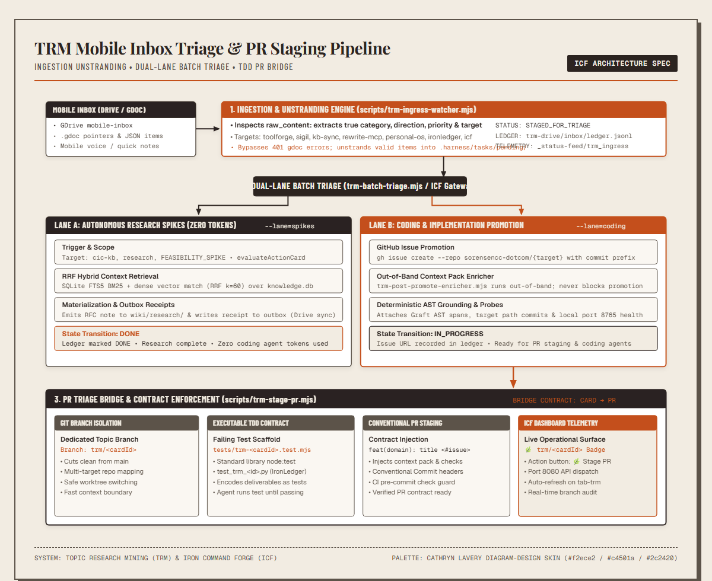
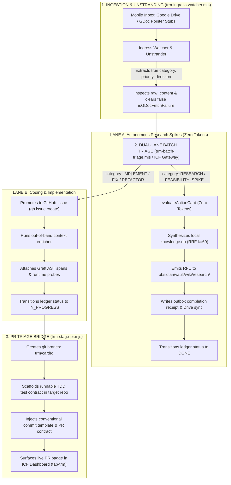

# TRM mobile inbox triage and PR staging pipeline

The Topic Research Mining (TRM) mobile inbox triage pipeline processes inbound action items from Google Drive through autonomous research spikes and pull request staging.

Mermaid source...

## Pipeline stages

### 1. Ingestion and unstranding
The ingress watcher runs as a background process or via CLI. It monitors Google Drive and local triage directories.

To unstrand incoming Google Docs cards, the watcher executes these operations:
1. Inspects raw file contents to identify category, direction, priority, and target repository.
2. Clears false `isGDocFetchFailure` flags when content length exceeds 50 characters.
3. Stages unstranded items into `.harness/tasks/pending/` with status `STAGED_FOR_TRIAGE`.
4. Appends structured metadata to `trm-drive/inbox/ledger.jsonl`.

### 2. Dual-lane batch triage
The batch triage engine processes pending action items without manual intervention.

#### Lane A: Autonomous research spikes
Lane A processes research topics and feasibility investigations.
1. The engine routes cards with `RESEARCH` category or `FEASIBILITY_SPIKE` direction to local evaluation.
2. `evaluateActionCard` executes locally using zero cloud LLM tokens.
3. The context engine queries `.kb_cache/knowledge.db` with reciprocal rank fusion at $k=60$.
4. The system outputs RFC notes to `obsidian/vault/wiki/research/`.
5. The pipeline writes completion receipts to `trm-drive/inbox/outbox/` and updates the ledger to `DONE`.

#### Lane B: Coding and implementation
Lane B processes coding tasks targeting production repositories.
1. The engine invokes `gh issue create` with conventional commit prefixes.
2. An out-of-band context enricher runs asynchronously and appends AST context.
3. Graft code spans and runtime health probes attach directly to the GitHub issue.
4. The ledger updates the card status to `IN_PROGRESS` with the live issue URL.

### 3. Pull request triage bridge
The PR bridge turns promoted coding tickets into isolated worktrees and test harnesses.
1. Creates an isolated git branch named `trm/<cardId>` from `main`.
2. Generates an executable test contract in `tests/trm-<cardId>.test.mjs` using `node:test`.
3. Injects conventional commit messages and explicit deliverable assertions.
4. Telemetry in Iron Command Forge renders the active branch badge `🌿 trm/<cardId>` on `tab-trm`.
